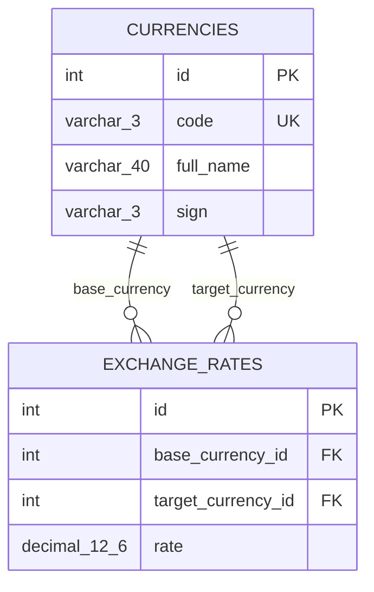

# Currency Exchange API

REST API для управления валютами и обменными курсами и для конвертации денежных сумм между валютами.

## Технологии

- Java 21
- Jakarta Servlet 6.1.0
- Apache Tomcat 11 через Gretty 5.1.0
- PostgreSQL 17
- HikariCP 5.1.0
- Gradle 9.3.0
- Gson 2.11.0
- MapStruct 1.6.3
- Lombok 1.18.34
- Docker Compose

## Архитектура

```text
HTTP-запрос
    |
    v
Filters -> Servlet -> Validator -> Service -> DAO -> PostgreSQL
                                      |
                                      v
                       DTO / Mapper / JSON-ответ
```

Проект построен по многоуровневой архитектуре:

- `servlet` и `filter`: маршрутизация HTTP-запросов, обработка CORS и формата данных
- `validator`: проверка входных параметров и бизнес-ограничений
- `service`: прикладная логика и логика конвертации
- `dao`: SQL-доступ к PostgreSQL
- `dto`, `model` и `mapper`: объекты передачи данных, доменная модель и преобразование данных
- `listener`: инициализация приложения, сборка зависимостей и жизненный цикл HikariCP
- `exception` и `ErrorServlet`: централизованная обработка ошибок

## База данных

В PostgreSQL используются две таблицы.

| Таблица | Назначение |
|---|---|
| `currencies` | Код, название и знак валюты |
| `exchange_rates` | Курс обмена между двумя валютами |



Инициализация базы выполняется автоматически из файла `src/main/resources/db/init.sql` при первом создании тома PostgreSQL.

## API

Базовый URL сервера разработки Gretty: `http://localhost:8080/api`

| Метод | Эндпоинт | Параметры | Назначение |
|---|---|---|---|
| `GET` | `/currencies` | - | Получить все валюты |
| `POST` | `/currencies` | `code`, `name`, `sign` | Добавить валюту |
| `GET` | `/currency/{code}` | - | Получить валюту |
| `GET` | `/exchangeRates` | - | Получить все обменные курсы |
| `POST` | `/exchangeRates` | `baseCurrencyCode`, `targetCurrencyCode`, `rate` | Добавить обменный курс |
| `GET` | `/exchangeRate/{baseCode}{targetCode}` | - | Получить обменный курс |
| `PATCH` | `/exchangeRate/{baseCode}{targetCode}` | `rate` | Обновить обменный курс |
| `GET` | `/exchange` | `from`, `to`, `amount` | Конвертировать сумму |

POST- и PATCH-запросы используют формат `application/x-www-form-urlencoded`.

### Примеры

Добавление валюты:

```bash
curl -X POST http://localhost:8080/api/currencies \
  -d "code=USD" \
  -d "name=US Dollar" \
  -d "sign=$"
```

Добавление обменного курса:

```bash
curl -X POST http://localhost:8080/api/exchangeRates \
  -d "baseCurrencyCode=USD" \
  -d "targetCurrencyCode=EUR" \
  -d "rate=0.92"
```

Получение обменного курса:

```bash
curl "http://localhost:8080/api/exchangeRate/USDEUR"
```

Конвертация суммы:

```bash
curl "http://localhost:8080/api/exchange?from=USD&to=EUR&amount=100"
```

Обновление курса:

```bash
curl -X PATCH http://localhost:8080/api/exchangeRate/USDEUR \
  -d "rate=0.90"
```

## Требования

- JDK 21
- Docker и Docker Compose
- Gradle доступен через Gradle Wrapper 9.3.0

## Конфигурация

Создайте файл переменных окружения:

```bash
cp .env.example .env
```

Настройте `.env`:

```dotenv
POSTGRES_USERNAME=postgres
POSTGRES_PASSWORD=your_password
POSTGRES_DB=currency_exchange
```

Подключение приложения к базе настроено в `src/main/resources/hikari.properties`. Эти значения должны совпадать с параметрами PostgreSQL:

```properties
jdbcUrl=jdbc:postgresql://localhost:5433/currency_exchange
username=postgres
password=your_password
driverClassName=org.postgresql.Driver
```

PostgreSQL доступен на порту хоста `5433`; внутри контейнера используется порт `5432`.

## Сборка и запуск

### 1. Запуск базы данных

```bash
docker compose up -d
```

Проверка состояния контейнера:

```bash
docker compose ps
```

### 2. Запуск приложения

Windows:

```powershell
.\gradlew.bat appRun
```

Linux/macOS:

```bash
./gradlew appRun
```

API доступен по адресу `http://localhost:8080/api`.

### Сборка WAR-файла

Linux/macOS:

```bash
./gradlew clean build
```

Windows:

```powershell
.\gradlew.bat clean build
```

Артефакт будет создан в `build/libs/`.

## Структура проекта

```text
src/main/java/com/currencyexchange/
├── dao/
├── db/
├── dto/
├── exception/
├── filter/
├── listener/
├── mapper/
├── model/
├── service/
├── servlet/
├── util/
└── validator/
src/main/resources/
├── db/init.sql
└── hikari.properties
src/main/webapp/WEB-INF/
└── web.xml
```
